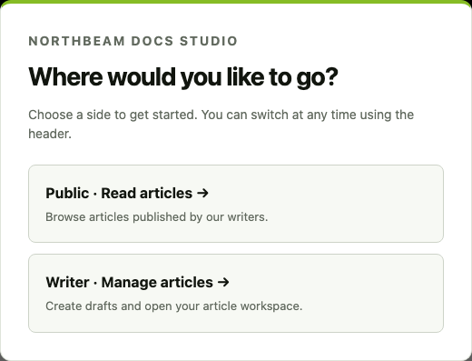
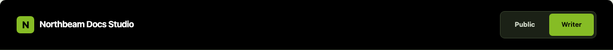
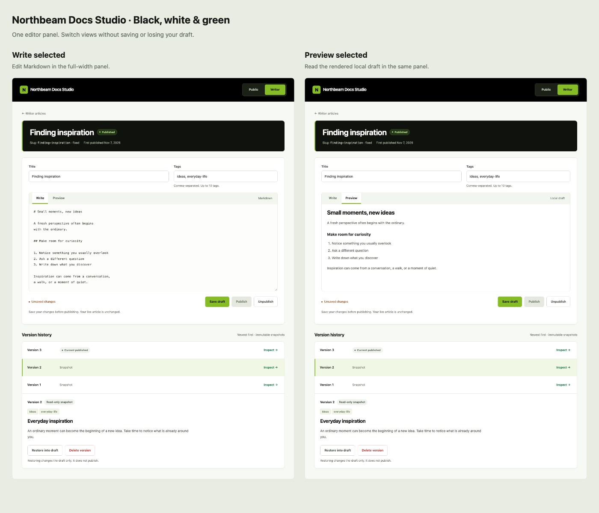

# UI Design: Northbeam Docs Studio

**Task**: T035 / Phase 3 / FR-012 (US12)
**Status**: Final rendered design explicitly approved by the user on 2026-11-07:
Deloitte-inspired black/white/green styling with Write/Preview tabs, history below,
and the documented responsive layouts and feedback states. Only this approved design
is retained in the preview assets.
**Scope**: Five screen wireframes, rendered visual mockups, and feedback states.
Writer list/creation, editable Write/Preview/save, and Phase 6 Publish follow this design.
Public list/detail, Unpublish, and Phase 10 read-only history follow the approved design.
Restore is implemented in Phase 11; Delete remains a target for its later phase.

Use the approved [specification](spec.md), [plan](plan.md),
[HTTP contract](contracts/http-api.md), and [UI/service boundaries](contracts/ui-and-services.md).
The wireframes show the eventual combined interface. Each feature phase adds only its
working controls and data; later actions are omitted until their implementation phase.

The public portal is an article-reading experience for any subject. Use “Articles”,
“All articles”, and “published articles” in public copy and general-interest sample
content. The assignment/product name remains Northbeam Docs Studio.

## Entry popup requested during Phase 4 review

The user requested a modal portal choice before displaying the homepage. Its two clear
actions are Public (published article list) and Writer (writer article list), matching the
existing routes `/` and `/writer/articles`. Remove the separate “Open writer workspace”
landing-page action. Keep the existing top-header switch available after selection.
The offline preview's “Preview entry popup” control demonstrates this flow with sample lists.



A native dialog provides a labeled heading, modal focus handling, keyboard-operable choices,
and the existing black/white/green appearance. Selected behavior: show on a fresh root-page
entry, keep the selection during client navigation, and do not interrupt deep links. Escape
may dismiss to the public side. The popup is navigation, not authentication or a saved role.
The user explicitly selected “Add chooser now; keep public list in Phase 7”. Writer opens
the implemented `/writer/articles` list; Public dismisses the popup to an Articles
placeholder at `/`. That placeholder makes no claim that a public list was loaded or
that no articles are published. The workspace landing action was removed. T011 has now
replaced the placeholder with the real public list in Phase 7.
Prototype checks passed Public/Writer selection, autofocus, Escape-to-Public, and
320/390/1440px fit in headless Chrome with no runtime exceptions. The Phase 4 application
implemented the same chooser with the agreed Articles placeholder: live-browser checks
also passed both choices, modal focus containment, Escape, root reload behavior, client
navigation, and deep links without hydration warnings. Typecheck, production build,
and all 108 existing tests pass.

## Rendered design previews

Open [the interactive preview](design-preview/index.html) directly in a browser; no server,
installation, or internet connection is needed. Use its review toolbar to switch between
all five screens, desktop/mobile canvas widths, and relevant feedback states.
The preview uses fixed sample content. Field edits and buttons do not connect to the
application or database; the Markdown preview is a fixed visual sample, not a live parser.
The actual feature UI still follows the implementation phases below.





| Screen | Rendered screenshot |
| --- | --- |
| Writer article list | [Writer list](design-preview/studio-writer.png) |
| Create draft | [Creation form](design-preview/studio-create.png) |
| Editor and history | [Write tab](design-preview/studio-editor-write.png), [Preview tab](design-preview/studio-editor-preview.png) |
| Public article list | [Public list](design-preview/studio-public.png) |
| Public article detail | [Public article](design-preview/studio-article.png) |
| Mobile editor and history | [Tabbed editor](design-preview/studio-editor-mobile.png) |

The preview contains the approved Write/Preview tab layout only. Unused layouts and
older screenshots were removed at the user's request. Any later visual change must be
recorded before dependent application work.

The approved tabbed layout passed 48 desktop/mobile screen-state checks in headless Chrome, with no JavaScript
exceptions or horizontal page overflow. Additional checks at 320px, 390px, and 1440px
verified tab selection, keyboard operation, and preservation of typed title/body/tags,
unsaved state, and Publish availability. The mockup's preview remains a fixed sample;
the application renderer will use current unsaved Markdown during its feature phase.
The black/white/green restyle passed the same 48 screen-state checks and keyboard/content
retention checks. Measured text contrast: black on accent green 9.23:1, dark-green links
on white 6.72:1, and muted text on the page background 5.37:1. These checks cover the
chosen text pairs, not a full accessibility audit.
The top-header Public/Writer switch passed 15 navigation scenarios covering all five
screens at 320px, 390px, and 1440px: both directions navigate to the correct list, exactly
one portal is current, and both links retain at least 44px-high touch targets. The 48
existing screen-state checks, tab keyboard behavior, and text-retention checks still pass.
These are prototype checks, not evidence that application lifecycle APIs/UI are implemented.

## Approved visual direction

| Option | Layout and appearance | Tradeoff |
| --- | --- | --- |
| Tabs — selected | Black navigation/heading surfaces, white content cards, green primary actions, compact article rows, and one full-width editor panel with Write and Preview tabs at every width. History stays below. | Gives writing and preview the full panel width; only one is visible at a time. Switching tabs preserves local edits and never saves or publishes. |

The wireframes below define the approved tabbed editor. Routes, dependencies, component boundaries, lifecycle
rules, and feature scope remain those already approved.

### Approved shared styling

- Native system sans-serif; base text 16px, page titles 32–40px on desktop and 28–32px on mobile, secondary labels 14px.
  Markdown source uses a system monospace font. No downloaded fonts or icon package.
- Deloitte-inspired palette: black `#000000`, white `#FFFFFF`, and green `#86BC25`,
  verified against the [Deloitte colour palette](https://www2.deloitte.com/content/dam/Deloitte/sg/Documents/careers/sg-careers-deloitte-sg-50th-anniversary-art-competition-art-colour-palette.pdf).
  Apply near-black navigation and editor-heading surfaces, white cards, warm pale-neutral
  page backgrounds, and green accents. Keep the Northbeam name and identity.
- Primary buttons use green `#86BC25` with black text; body links and focus indicators use
  darker green `#046A38`. Keep normal text dark on light backgrounds, with muted neutral
  metadata. Retain semantic red destructive/error states and amber conflict warnings.
  Every state has a text label; bright green is not used for small text on white.
- Center content within about 1152px; public reading within about 768px. Use a small
  spacing scale: 8px between related controls, 16px within sections, 24–32px between sections.
  Use 10–12px card corners, restrained shadows, stronger heading typography, and a green
  accent rule on the editor heading. Keep content-led layouts without decorative dashboards or illustrations.
- The shared top header includes a segmented **Public / Writer** navigation switch.
  Public opens `/`; Writer opens `/writer/articles`. Highlight the current portal in green
  on both list and detail pages. Keep it visible on mobile, wrapping below the wordmark.
  Use ordinary keyboard-accessible links in a labeled navigation group, with `aria-current`
  on the current portal and at least 44px touch targets. The Northbeam wordmark also links
  to `/`. Both portals use the existing trusted-writer setup; no new routes or authentication
  flow are added. No search or pagination controls.
- Visible input labels, keyboard focus rings, semantic buttons/links, and readable inline
  field errors. Use at least 44px-high action controls; avoid horizontal page scrolling.
  Announce action results and give conflict/error banners an accessible label.

## 1. Writer article list — `/writer/articles`

```text
Northbeam Docs Studio                           [ Public | Writer ]

Writer articles                                      [New article]
Open an article to work on its draft.

TITLE                                      STATUS
Finding inspiration                            Published       [Open]
A fresh perspective                         Draft           [Open]
A quieter weekend                         Unpublished     [Open]
```

Titles come from saved drafts, even when published content has a different title.
Title/Open links target `/writer/articles/:articleId`; New article targets
`/writer/articles/new`. The summary response supplies ID, slug, draft title, and status;
this list needs only title/status. Do not invent dates or version counts.

At small widths, each row becomes a vertical title/status/Open group. The heading and
New article action wrap naturally. Empty state: “No articles yet. Create your first draft.”

## 2. Create a draft — `/writer/articles/new`

```text
Northbeam Docs Studio                           [ Public | Writer ]

< Back to writer articles
New article

Title
[Finding inspiration____________________________________________]
Required; up to 200 Unicode characters.

Slug
[finding-inspiration____________________________________________]
Lowercase letters/numbers and single hyphens; up to 100 characters.
The slug cannot change after creation.

[Create draft]   Cancel
```

Creation asks for title and slug only; body and tags begin empty under the approved
defaults. Do not generate a slug or suffix collisions automatically. Explain trimming
and lowercasing through validation feedback without rewriting internal spaces.

Show field errors beside their inputs. A slug collision says “This slug is already in use.
Choose another.” Keep both inputs on failure. Disable repeat submission while pending;
label the action “Creating…”. Success navigates to the new article's editor, displaying
its saved draft. Cancel returns to the writer list. The form stays one column at all widths.

## 3. Article editor, preview, and history — `/writer/articles/:articleId`

```text
Northbeam Docs Studio                           [ Public | Writer ]

< Writer articles
Finding inspiration
Status: Published
First published: Nov 7, 2026
Slug: finding-inspiration (fixed)

[Feedback banner, when needed]

Title
[Finding inspiration____________________________________________]
Tags
[ideas, everyday-life_______________________________________________]
Separate tags with commas; up to 10. Tags use letters/numbers/hyphens.

[Write — selected]   [Preview]
+-----------------------------------------------------------------+
| # Welcome                                                       |
| Write Markdown here…                                            |
|                                                                 |
+-----------------------------------------------------------------+
Preview shows rendered local Markdown in this same panel.

Unsaved changes — save before publishing.
[Save draft]   [Publish]   [Unpublish]

Version history — newest first
VERSION                   REFERENCE                          ACTION
3                         Current published                  [Inspect]
2                         —                                  [Inspect]

Selected: Version 2 — read-only snapshot
Title: Everyday inspiration       Tags: ideas
[Rendered snapshot content]
[Restore into draft]   [Delete version]
Restoring changes the draft only; it does not publish.
```

The upper form is editable local content. Preview renders that local draft with the
shared Markdown renderer; it is never described as the current public content. Snapshot
inspection is a separate, clearly read-only region using the same renderer.
History rows use only the version-summary ID/number and the article's current reference;
title/body/tags appear after loading the selected version detail. Publication feedback
does not assume a version number in the WriterArticle response.

Use one full-width panel with Write/Preview tabs at every screen width. Write is selected
initially and contains the Markdown textarea; Preview shows the current local draft through
the shared renderer. Tab changes require no Save, never publish, and preserve title, tags,
body, dirty state, saved revision, and feedback. History stays below; its rows become
vertical groups on narrow screens.

Use labeled tabs with selected state and associated panels. Arrow keys and Home/End move
between tabs; only the active panel is visible. Keep keyboard focus on the selected tab
and allow normal Tab navigation into its panel. Keep Save/Publish/Unpublish outside the
tab panel so action availability does not change when previewing. Buttons wrap in reading order rather than becoming a sticky overlay.
Status shows “Draft”, “Published”, or “Unpublished” independently of the local
“Unsaved changes” indicator. Publication metadata is absent for never-published articles.

### Action behavior

| Action | Availability and result |
| --- | --- |
| Save draft | Enabled when loaded and no conflicting action is pending, including unchanged content. Validate inputs; on success update the saved baseline/revision and show “Draft saved.” Retain edits made after the request began. |
| Publish | Separate from Save. Disabled while local content is dirty or saved body is blank, with an adjacent reason. After explicit successful Save, permit publishing saved content. An unchanged republish is allowed and creates a new version; success says “Article published. A new version was created.” |
| Unpublish | Available only while saved status is Published, and serialized with other actions. Local unsaved edits stay in the buffer; success reports that the article is no longer public. |
| Inspect | Select an owned history entry and load its read-only content. This never changes the draft or publication state. |
| Restore into draft | Allowed for any retained owned version, including the current/last-published version. If local text is dirty, first confirm replacement with a small inline Confirm/Cancel prompt. Success loads the restored draft and reports that publication is unchanged. Identical restores remain allowed. |
| Delete version | Offered for the inspected unreferenced version, with an inline confirmation naming its version number. Success refreshes history without changing the draft/revision. The referenced version instead shows “Protected — current published version” or “Protected — last published version”; omit its Delete action. |

Unpublishing retains the reference, first publication date, and protected history entry.
It does not relabel that snapshot as deletable. Restore and Delete can still fail if
another writer changes state; the API is authoritative. No version diff or save-as-version
action is included.

### Conflict and response handling

Show: “This article changed in another tab or session. Your local text is still here.”
Keep local inputs and preview intact. Do not auto-save, auto-retry, silently rebase, or
replace inputs with a response that arrived after newer local edits.

Offer an explicit “Reload saved article” action. If it would discard local edits, first
show “Reloading replaces your local edits with the saved draft” with Confirm/Cancel.
After reload, the writer may edit and explicitly resubmit using the refreshed revision.
Failed/uncertain requests do not silently become successes or trigger another write.


**Phase 7 implementation**: T011 replaces the earlier root placeholder with the real public
list while retaining the chooser and portal navigation. Rows use live summary fields,
wrap on mobile, omit empty tag groups, and provide loading/empty/error/retry feedback.
Article-detail links retain their approved URLs; Phase 8 now implements their destination pages.

## 4. Public article list — `/`

```text
Northbeam Docs Studio                           [ Public | Writer ]

Articles

Finding inspiration                                         [Read article]
ideas  everyday-life
First published Nov 7, 2026
-------------------------------------------------------------------
A fresh perspective                                      [Read article]
perspective
First published Nov 6, 2026
```

Title/Read article links target `/articles/:slug`. Display title, tags, and first
publication date from the public response only. Do not show draft status, internal IDs,
revisions, history, or writer controls. Empty state: “No published articles yet.”
Rows stack naturally at small widths; omit the tag group when empty. No preview excerpt
is invented because the public list contract has no body field.

## 5. Public article detail — `/articles/:slug`

```text
Northbeam Docs Studio                           [ Public | Writer ]

< All articles
Finding inspiration
ideas  everyday-life
First published Nov 7, 2026

Welcome
Rendered Markdown content from the live snapshot…
```

Use a readable single column with headings, lists, links, and code styling supplied by
the existing Tailwind approach. Code blocks may scroll within their own region.
Raw HTML is displayed literally; only approved link schemes become clickable. The same
renderer supplies editor preview and snapshot inspection. No separate rendering policy.

Missing, draft-only, and unpublished articles show the same 404 page: “Article not found”
and a link back to all articles. Never fall back to draft or retained snapshot data.
Republishing keeps the displayed first publication date.


**Phase 8 implementation**: The reader uses the approved single column, shared Markdown,
live metadata, and All articles navigation. Missing states share friendly HTTP 404, and
failed reads offer Retry/loading recovery. Browser checks verified matching preview,
draft isolation/republish, and 320/390/1440px long-title/code layouts without hydration or
runtime errors. Return-link targets meet 44px; code scrolling stays within the content block.


**Phase 9 implementation**: Unpublish is offered only while published, remains usable
with dirty content, and retains the local buffer even during delayed responses. Metadata
retains the first date and labels Last published snapshot after success. Existing pending/
conflict/reload feedback is reused; state errors request explicit reload. Browser checks
verified actual public removal, republish, two-tab conflicts, network retry, and responsive
three-action layouts with 44px targets. History controls remain in later phases.


**Phase 10 implementation**: Version history sits below the editor with newest-first
numbers, Current published/Last published labels, and a separate read-only inspection
region. Shared Markdown renders only the selected snapshot; local inputs remain intact.
Refresh and separate list/inspection loading/error/retry feedback are implemented. Browser
checks passed old/current/retained inspection, safe content, missing-version feedback,
local/stored/public isolation, and 320/390/1440px layouts with 44px controls and no final
hydration/runtime warnings. Restore/Delete controls remain in later phases.


**Phase 11 implementation**: Inspected snapshots offer Restore into draft separately
from publication. Dirty input prompts name the captured version and provide Confirm restore/
Cancel restore. Success reports not published; stale/missing/network failures retain local
text, and newer typing survives delayed success. Browser checks verified old/current/
last-published/identical targets, explicit reload/resubmit and subsequent Save/Publish,
public/history isolation, and 320/390/1440px confirmation controls with 44px targets and no
runtime/hydration errors. Delete remains in its owning later phase.

## Feedback states across screens

| State | Approved presentation and recovery |
| --- | --- |
| Loading | Visible “Loading articles…”, “Loading draft…”, or “Loading version…” in the affected region. Before an editor loads, do not display a blank editable form that could overwrite saved data. |
| Pending write | Action-specific text (“Saving…”, “Publishing…”, etc.); serialize conflicting actions. If further field edits occur, preserve them when the response arrives. |
| Empty | Writer/public messages above; history says “No published versions yet.” Empty history is not a load failure. |
| Validation | Inline messages connected to affected fields plus a short form error summary. Retain entered values; enforce the approved Unicode limits and normalized tag/slug rules. |
| Success | Text banner describing the completed action; publishing confirms creation of a new version, restoring explicitly says “not published”. |
| Request failure | Readable generic message; explicit Retry for failed reads only. Keep local edits on failed writes and allow deliberate resubmission. No database or stack details. |
| Stale revision | Persistent conflict banner and explicit reload flow above; local text survives until the writer chooses replacement. |
| Protected deletion | Visible reference label and no Delete action for that version. If a race returns protection, report it without removing the history entry or draft. |
| Missing writer target | “Article not found” or “Version not found” with a path back to the containing list/history; do not render stale inspected content as a successful new selection. |

## Route, component, and phase mapping

| Screen/region | Approved source or owner | First implementation |
| --- | --- | --- |
| Writer list/create/read-only editor | `app/pages/writer/articles/index.vue`, `new.vue`, `[articleId].vue` | T022 / Phase 4 |
| Editable form/state | `ArticleEditorForm.vue`, `useArticleEditor.ts` | T023 / Phase 5 |
| Local preview/shared rendering | `MarkdownContent.vue`, `shared/utils/markdown.ts` | T013/T023 / Phase 5 |
| Publish | Existing editor/form/composable | T024 / Phase 6 |
| Public list | `app/pages/index.vue` | T011 / Phase 7 |
| Public detail | `app/pages/articles/[slug].vue`, shared `MarkdownContent.vue` | T039 / Phase 8 |
| Unpublish | Existing editor/form/composable | T036 / Phase 9 |
| History list/inspection | `ArticleHistory.vue`, existing editor/composable | T025 / Phase 10 |
| Restore/Delete | Existing history/composable | T037 / Phase 11; T038 / Phase 12 |

Component filenames above are under `app/components/`; the composable is under
`app/composables/`. These are the existing approved boundaries, not newly introduced modules.
There are no additional routes, libraries, authentication flows, or backend changes.

## Review gate

After reviewing the rendered previews, the user explicitly approved the final
black/white/green tabbed design on 2026-11-07. This approval covers the current styling,
layouts, and documented interaction/feedback states.

T035 is complete. Phases 1–10 are approved. Phase 11 Restore is implemented and verified,
pending human approval. Delete arrives later.
Later visual changes require human approval.
Wireframes and rendered previews demonstrate design intent. Prototype checks are recorded
above; actual application browser, responsive, and accessibility behavior must still be
checked in the owning feature phases.
